<h1 align="center">Magic City Code</h1>

<p align="center"><strong>Magic City Code helps students learn to code by fixing real Birmingham city problems.</strong></p>

<p align="center">
  
  
  
  
  
  
</p>

<p align="center">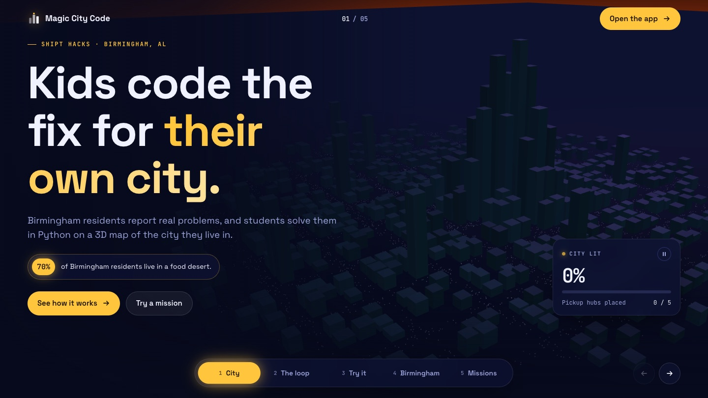</p>

<p align="center">
  <a href="#the-idea">The idea</a> ·
  <a href="#see-it">See it</a> ·
  <a href="#how-it-works">How it works</a> ·
  <a href="#where-ai-is-used">AI</a> ·
  <a href="#tech-stack">Tech stack</a> ·
  <a href="#quick-start">Quick start</a> ·
  <a href="#data-and-honest-limits">Data</a> ·
  <a href="#team">Team</a>
</p>

---

## The idea

Kids learn to code on games about made-up worlds. Birmingham has real problems: about 70% of residents live in a food desert, the water utility loses about half its water revenue to leaks and unbilled use, and about a third of the city's 27,000 storm drains need repair.

Magic City Code turns those problems into coding levels. A resident reports a problem, AI turns it into a mission on a 3D night map of the real city, a student solves it with a few lines of Python, and the result goes back to the community as a proposal.

> **Student code never draws anything.** It returns a list of actions. One pure engine scores them, so the map is safe, the answer is always the same for the same input, and before/after compare comes for free. AI writes mission text and hints. It never writes engine code and never gives the answer.

<table align="center">
<tr>
<td align="center"><strong>7</strong><br><sub>coding challenges</sub></td>
<td align="center"><strong>5</strong><br><sub>map missions</sub></td>
<td align="center"><strong>4</strong><br><sub>city problem projects</sub></td>
<td align="center"><strong>207</strong><br><sub>passing tests</sub></td>
<td align="center"><strong>0</strong><br><sub>student code run on a server</sub></td>
<td align="center"><strong>0</strong><br><sub>AI calls without a fallback</sub></td>
</tr>
</table>

## See it

### 1. Pick a problem on the night map

Every dot is a household. Every flare is a real problem a neighbor reported.

<p align="center">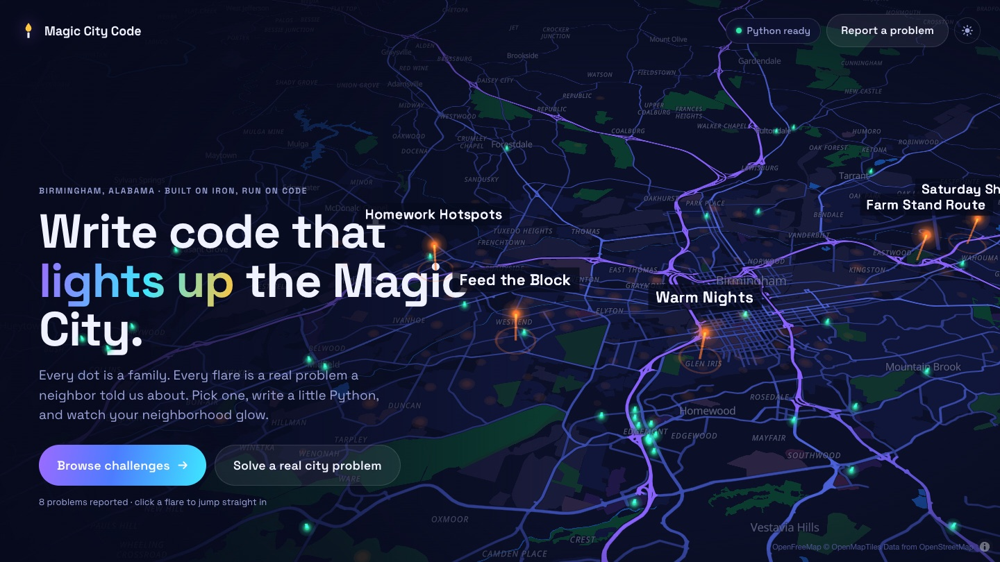</p>

### 2. Write a few lines of Python and light up the city

The mission screen has the story on the left, your code under it, and the map on the right. Press Run, and the households within a ten-minute walk of your stop turn gold. Hold **B** to compare with the city today.

<p align="center">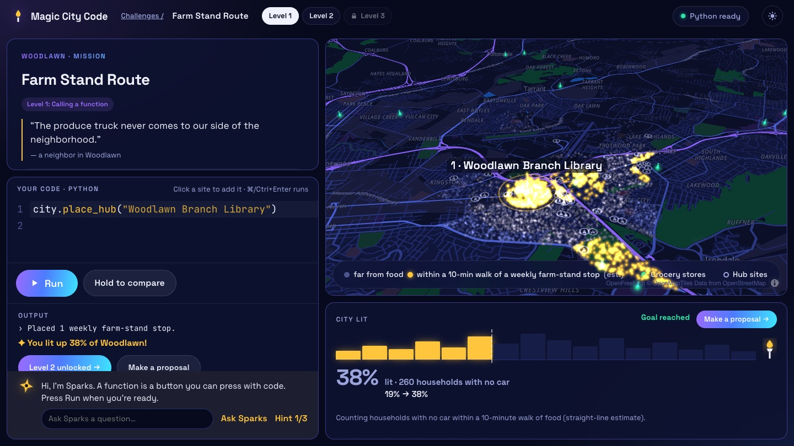</p>

### 3. Practice on real data

Seven challenges run on real Birmingham data, with hidden tests and a map replay of your answer.

<p align="center">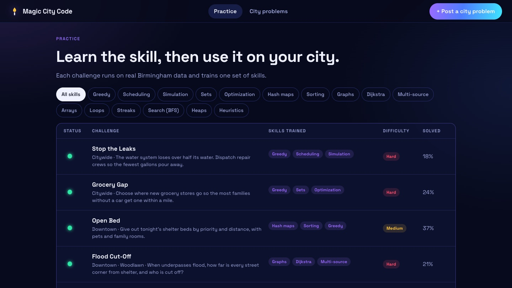</p>

<table>
<tr>
<td width="33%">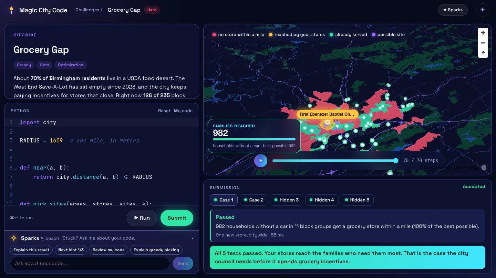<br><sub><strong>Grocery Gap.</strong> Greedy max coverage. Choose store sites so the most households without a car are within a mile.</sub></td>
<td width="33%">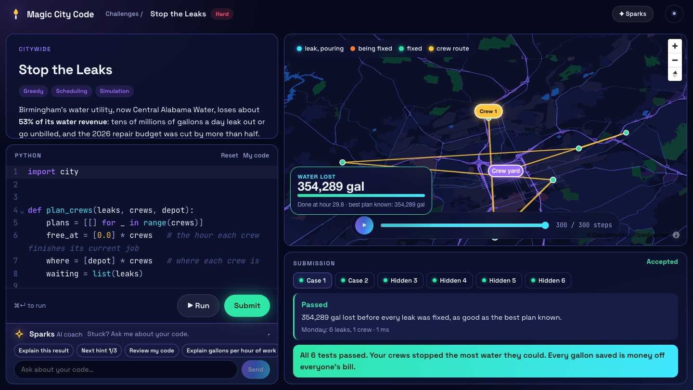<br><sub><strong>Stop the Leaks.</strong> Greedy scheduling. Dispatch crews so the fewest gallons pour away.</sub></td>
<td width="33%">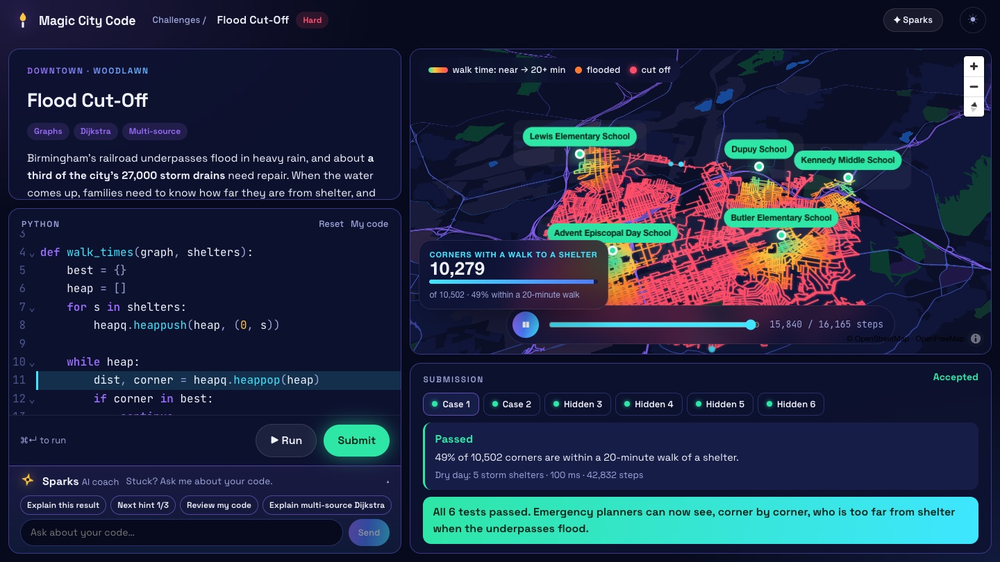<br><sub><strong>Flood Cut-Off.</strong> Multi-source Dijkstra over 10,502 real street corners.</sub></td>
</tr>
</table>

The full list, ranked by impact, is in [docs/top-problems.md](docs/top-problems.md): Stop the Leaks, Grocery Gap, Open Bed, Flood Cut-Off and Water Bill Check, then Route to Fresh Food, Stray-Dog Van Route and Feed the Block.

### 4. Solve problems posted by neighbors

A neighbor posts a problem with its data. Coders open it as a small Python project, with files, a README and tests, then run the tests and submit. The poster picks the solution that works.

<table>
<tr>
<td width="50%">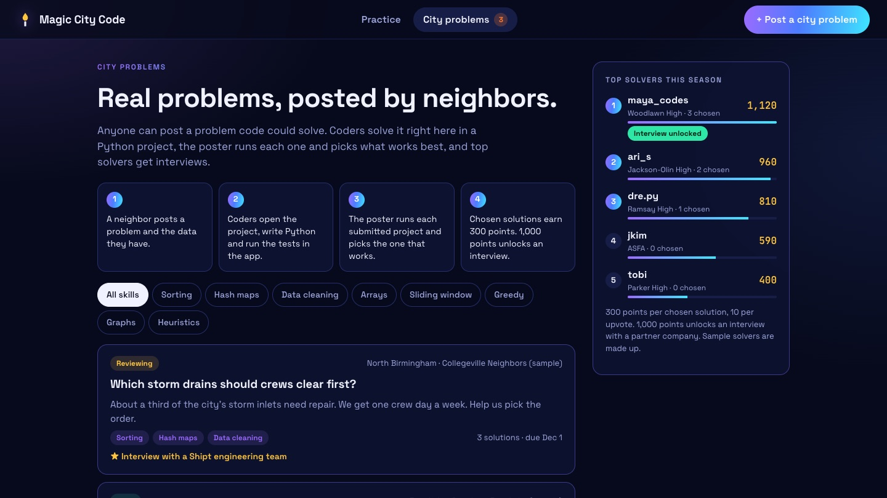<br><sub><strong>City problems.</strong> Problems from neighbors and a season leaderboard. The sample posters and solvers are made up.</sub></td>
<td width="50%">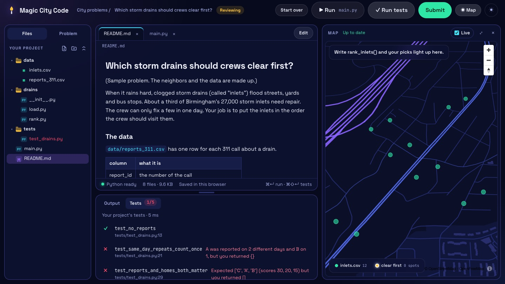<br><sub><strong>Workspace.</strong> File tree, editor, Run tests, Submit and a live map of your picks.</sub></td>
</tr>
</table>

### 5. The story, on the landing page

<table>
<tr>
<td width="50%">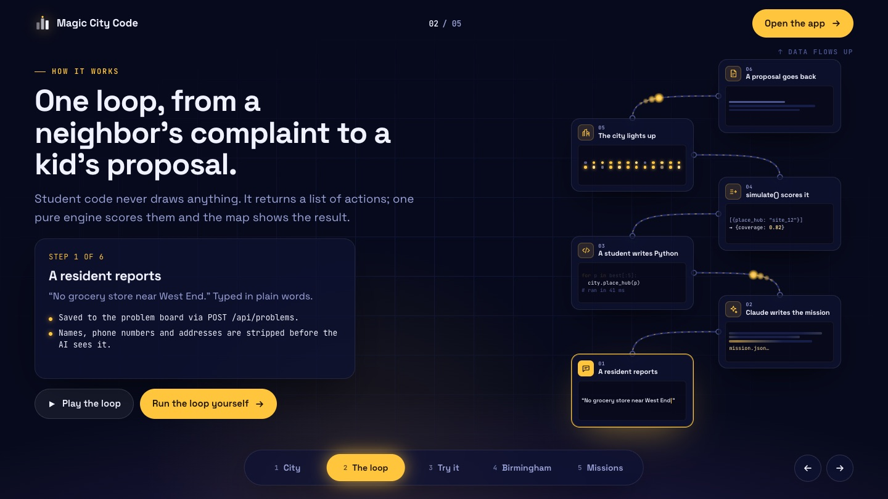<br><sub><strong>The loop.</strong> From a neighbor's complaint to a kid's proposal, in six steps.</sub></td>
<td width="50%">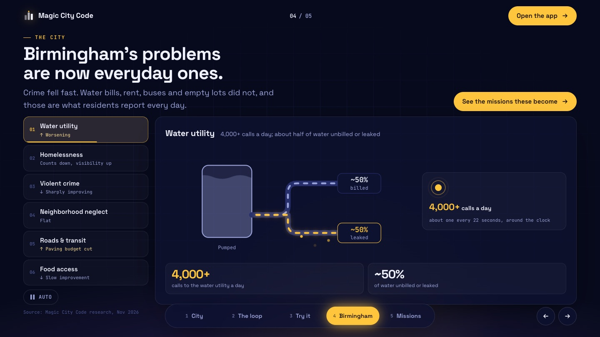<br><sub><strong>The city.</strong> Six real problems, each with a sourced number.</sub></td>
</tr>
</table>

## How it works

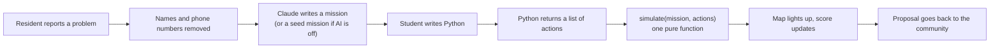

### Architecture

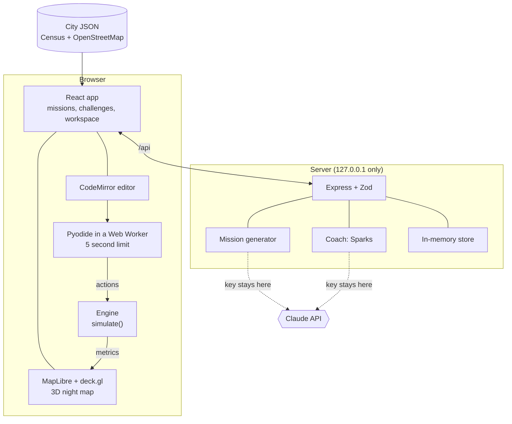

### Why it is built this way

| Choice | What it gives |
|---|---|
| Python returns **actions**, not drawings | Safe to run, easy to explain, same input gives the same answer |
| Real Python in a **Web Worker**, 5 second kill | A bad loop cannot freeze the page, and no student code runs on a server |
| Coverage scored with **weighted resident dots** | Fixes the threshold errors of block-group centers |
| Mission targets set by **the real engine**, not by AI | A generated mission can never be unwinnable |
| Challenge pass marks **measured** from common wrong answers | A correct answer never fails on stage |
| The server listens on **127.0.0.1** only | Nobody on the venue Wi-Fi can reach it |

Every choice and what was rejected is in [docs/decisions.md](docs/decisions.md).

## Where AI is used

| Where | What it does | What it may not do |
|---|---|---|
| **Mission generator** | Turns a resident's words into a mission config, checked by a schema, with one retry | Write engine code, or set the score target |
| **Coach (Sparks)** | Gives one hint at a time, streamed | Give the solution. A leak guard cuts off any reply that starts repeating it |
| **Claude Code subagents** | Built the app, one folder each (see below) | Skip review. A reviewer agent found and fixed real bugs |

Every AI call has a fallback: no key, a timeout or a bad reply falls back to a seed mission, a keyword classifier or a stored hint. The app works fully offline. Names, phone numbers, emails and addresses are removed before any text is saved or sent to Claude, and an adult approves a generated mission before students see it.

What AI wrote, what was kept and what was rejected is logged in [docs/ai-log.md](docs/ai-log.md).

## Tech stack

<p align="center">
  
  
  
  
  
  
  
  
  
  
  
  
  
</p>

| Layer | Choice | Why |
|---|---|---|
| App | React 18, TypeScript, Vite 6 | Fast to build. Vite 7 needs Node 20.19, so we pinned Vite 6 |
| 3D map | MapLibre GL, OpenFreeMap tiles | Free, no API key, real building footprints |
| Data layers | deck.gl | Draws thousands of glowing resident dots smoothly |
| Student code | Pyodide (real Python) in a Web Worker | No server runs student code, and a bad loop cannot freeze the page |
| Editor | CodeMirror 6 | Lighter than Monaco, runs well on school Chromebooks |
| Server | Node 20, Express, Zod | One language across the app, and Zod checks every AI response |
| AI | Claude API through `@anthropic-ai/sdk` | Structured output for missions, streaming for the coach |
| Data | Python scripts: Census ACS files, OpenStreetMap | Run once, written to plain JSON |

## Quick start

```bash
pnpm install
cp .env.example .env        # optional: add ANTHROPIC_API_KEY. The app works offline without it.
pnpm dev
```

Needs Node 20.17 or newer and pnpm 9. `pnpm dev` runs the web app, the landing page and the server in parallel (`pnpm dev:app` skips the landing page). Open **http://localhost:5173** for the app. The landing page is a separate site on **http://localhost:5180**; its links go to the app (set `VITE_APP_URL` to point them somewhere else).

Demo shortcuts:
- **Ctrl+Shift+1 / 2 / 3** types the prepared solution for level 1, 2 or 3.
- **Hold B** to compare the city today with your plan.
- **D** switches day and night maps.
- **⌘/Ctrl+Enter** runs your code.
- Visit **http://localhost:5173/?reset=1** to clear saved state before a demo.

### Tests

```bash
pnpm -r typecheck
pnpm -r test        # 207 tests: 138 web, 69 server
```

The challenge tests run every reference solution and every starter in real Pyodide. Solutions must pass, starters must fail, and known wrong answers must be caught.

## Repo layout

| Folder | What it holds |
|---|---|
| `web/` | The React app: 3D map, Python editor and worker, missions, challenges, workspace, landing page |
| `server/` | Express server: mission generator, coach, proposals, city problems, fallbacks. The Claude key lives only here. See [server/README.md](server/README.md) |
| `shared/` | Types shared by web and server |
| `data/` | Offline pipeline that writes the city JSON. See [data/README.md](data/README.md) |
| `docs/` | Plans, the AI log, the decisions record, the demo script, and the screenshots in `docs/media/` |
| `reports/`, `research_notes/` | The research behind the problems |
| `.claude/agents/` | The Claude Code subagent role files used to build the app |

Docs: [SUBMISSION.md](SUBMISSION.md) · [docs/demo-script.md](docs/demo-script.md) · [docs/implementation-plan.md](docs/implementation-plan.md) · [docs/ui-plan.md](docs/ui-plan.md) · [docs/ui-integration.md](docs/ui-integration.md) · [docs/showcase-examples.md](docs/showcase-examples.md) · [docs/top-problems.md](docs/top-problems.md) · [docs/ai-log.md](docs/ai-log.md) · [docs/decisions.md](docs/decisions.md)

## Data and honest limits

- **City boundary and block groups:** US Census TIGERweb.
- **Households, no-vehicle households, under 18, 65+, poverty and no internet:** ACS 2023 5-year summary files.
- **Stores, sites and community places:** OpenStreetMap, through Overpass.
- **Neighborhoods:** the city's official neighborhood layer.

Limits we state on screen and here:
- Walking times are straight-line estimates, not road routes.
- Counts are households, not people.
- OpenStreetMap store coverage may be incomplete, especially in west Birmingham.
- There is no public data on where people sleeping outside are. Warm Nights counts seniors and low-income households instead, and the app says so.
- Open Bed and the sample city problems use made-up people, neighbors and data. Never real client data.
- The leaderboard solvers are made up.

## Built with Claude Code subagents

The app was built by Claude Code subagents, each owning one folder, with a reviewer agent checking the work.

| Agent | Owned |
|---|---|
| data-prep | `data/` pipeline |
| engine-builder | `web/src/engine/` |
| python-sandbox | Pyodide worker, editor, plain-words errors |
| server-ai | `server/`: generator, coach, fallbacks |
| map-visuals | 3D map and deck.gl layers |
| mission-content | the five showcase missions |
| mission-ui | the screens |
| code-reviewer | review and fix batches |
| demo-qa | demo runs and bug reports |
| docs-scribe | the AI log and decisions record |

## Team

| Who | Area |
|---|---|
| Pranay | Backend, challenges and tests: `server/`, `shared/`, `data/`, the engine, `web/src/challenges/`, the test suites |
| Margulan | Frontend and research: screens, map, landing page, editor, `reports/`, `research_notes/` |

Full folder ownership and the explain-back plan: [SUBMISSION.md](SUBMISSION.md).

Built for **Shipt Hacks** in Birmingham, Alabama, where it won first place.
